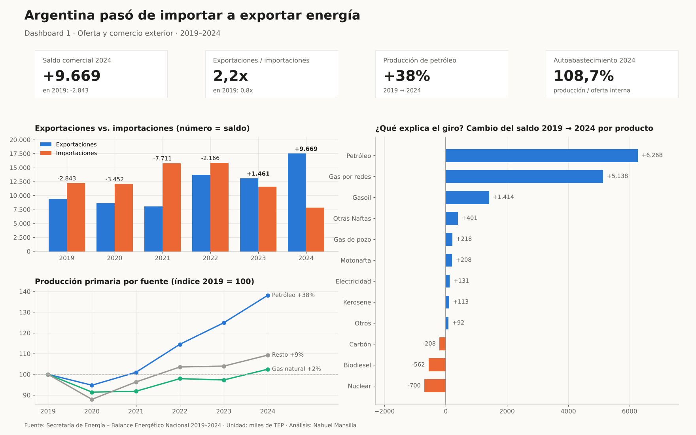
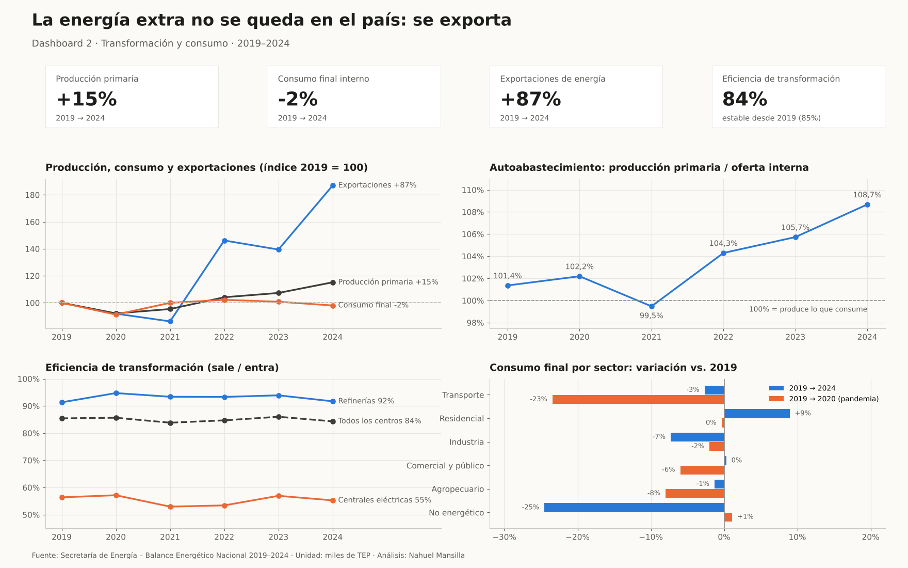

# Balance Energético de Argentina (2019–2024)

> **¿Argentina se está convirtiendo en un país exportador de energía?**
> Sí. Desde **2023** el país exporta más energía de la que importa y en 2024 ya exporta **2,2 veces** lo que importa,
> impulsado por el crecimiento de la producción de **petróleo (+38%)** en la era de Vaca Muerta.

Proyecto de análisis de datos sobre el Balance Energético Nacional, en dos partes:

| Parte | Qué hace | Archivo |
|---|---|---|
| **1. Limpieza y exploración** | Conversión del Excel de formato ancho a largo, limpieza, tablas por tipo de energía y dashboards descriptivos en Tableau | `energia_1_ejecutado.ipynb`, `Analisis.pdf`, `Distribucion_Energia_ARG_Comparacion_RE.twbx` |
| **2. Indicadores y conclusiones** | Indicadores propios de Oferta → Transformación → Consumo para responder una pregunta concreta | `energia_2_autosuficiencia.ipynb` |

---

## Parte 2 · Dashboards





## Hallazgos principales

| Indicador | 2019 | 2024 |
|---|---|---|
| Producción primaria (miles de TEP) | 78.240 | 90.128 (**+15%**) |
| Saldo comercial energético (expo − impo) | −2.843 | **+9.669** |
| Tasa de cobertura (expo / impo) | 0,77 | **2,23** |
| Autoabastecimiento (producción / oferta interna) | 101,4% | **108,7%** |
| Eficiencia de transformación | 85,4% | 84,3% |
| Consumo final interno (miles de TEP) | 55.685 | 54.580 (**−2%**) |

1. **Oferta:** el petróleo explica el **84%** del aumento de la producción primaria. El gas propio permitió bajar las importaciones de gas de 5.698 a 2.293 miles de TEP.
2. **Comercio:** el saldo cambia de signo en **2023**. La mitad de la mejora viene de exportar más petróleo y otra gran parte de importar menos gas.
3. **Transformación:** la eficiencia de refinerías y centrales se mantuvo estable (~85%), así que el giro **no** vino de transformar mejor la energía, sino de producir más.
4. **Consumo:** el consumo interno no creció (−2%). La pandemia golpeó al transporte (−23% en 2020). **El excedente de producción se exporta.**

## Indicadores construidos

- **Saldo comercial energético** = Exportaciones − Importaciones (primaria + secundaria; en comercio no hay doble conteo)
- **Tasa de cobertura** = Exportaciones / Importaciones
- **Saldo sin nuclear**: control de robustez, porque el balance registra la energía nuclear como importada por convención
- **Autoabastecimiento** = Producción primaria / Oferta interna primaria (solo primaria, para no contar dos veces)
- **Eficiencia de transformación** = Energía que sale / energía que entra, por centro (refinerías, centrales eléctricas, total)
- **Índices base 2019 = 100** para comparar ritmos de crecimiento entre series de distinto tamaño

### Decisión de calidad de datos
Las filas `TOTAL I` / `TOTAL II` de la base **no coinciden con la suma del detalle** en los 8 centros de transformación (solo registran los insumos, no lo producido).
Por eso todos los indicadores se recalculan desde el detalle por fuente. El notebook incluye la celda que lo demuestra.

## Limitaciones
- Los datos están en **energía (TEP), no en dólares**. El saldo en dólares depende además de los precios internacionales.
- La base **no separa la producción por cuenca**: la atribución a Vaca Muerta proviene de contexto externo.
- "Exportación y bunker" incluye el combustible vendido a barcos y aviones internacionales.
- Son solo 6 años: alcanzan para describir la tendencia, no para proyectarla.

---

## Estructura del repositorio

```
├── energia_1_ejecutado.ipynb          # Parte 1: limpieza y exploración
├── energia_2_autosuficiencia.ipynb    # Parte 2: indicadores y conclusiones
├── Base_energetica_limpia.csv         # Base limpia (entrada de la Parte 2)
├── indicadores_energia_2019_2024.csv  # Indicadores por año (salida de la Parte 2)
├── datos_tableau_parte2.xlsx          # Tablas listas para Tableau (indicadores, comercio, producción, consumo, eficiencia)
├── graficos_parte2/                   # Gráficos del notebook
├── dashboards/                        # Dashboards + script que los genera
├── Analisis.pdf                       # Informe de la Parte 1
└── Distribucion_Energia_ARG_Comparacion_RE.twbx   # Dashboards Tableau de la Parte 1
```

**Cómo ejecutarlo:** clonar el repo, instalar `pandas numpy matplotlib seaborn openpyxl` y abrir `energia_2_autosuficiencia.ipynb` (corre de punta a punta en orden).
Los dashboards se regeneran con `python dashboards/generar_dashboards.py` desde la raíz del repo.

## Fuente de datos
[Balances Energéticos – Secretaría de Energía, Ministerio de Economía](https://www.argentina.gob.ar/economia/energia/planeamiento-energetico/balances-energeticos)

## Herramientas
Python (pandas, numpy, matplotlib, seaborn) · Jupyter · Tableau Public · Excel

---
**Autor:** Nahuel Mansilla · Estudiante de Ciencia de Datos (Teclab)
